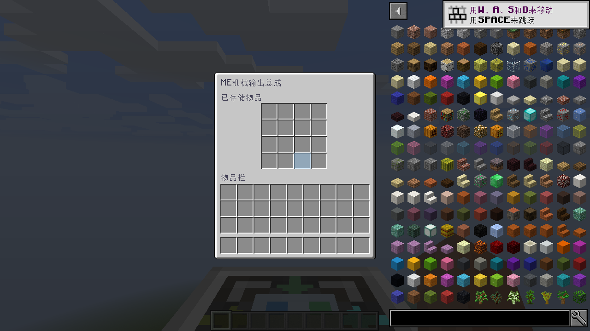

# AE2S 安装产物验收

本目录收录实际安装 JAR 的功能报告、加载器与模组哈希、回归摘要和输出总成修复截图。
客户端与专服均使用 Java 25，以及依赖锁中未修改的官方 MMCE、AE2S 和 AppliedCompatibility。
完整命令、运行库哈希、日志及其余截图保留在本地 `verification/evidence/`，不随源码提交。
每份精简 `runtime.json` 记录原始清单的 SHA-256。

## 当前输出总成 UI 修订

[当前产物清单](artifacts.json)中的安装 JAR SHA-256：

`c578dfa7b91da019119af7c647ecd659254bfd72997fd76eb17f72dade897af1`

| Cleanroom | 侧 | 结果 | 功能检查 | 基础 GUI / 气体 GUI |
| --- | --- | --- | --- | --- |
| 0.6.13-alpha | 专服 | [FUNCTIONAL_PASS](ui-fix-cr-0.6.13-alpha-gas/server/result.json) | 27 | — |
| 0.6.13-alpha | 中文客户端 | [FUNCTIONAL_PASS](ui-fix-cr-0.6.13-alpha-gas/client/result.json) | 27 | 6 / 7 |

输出总成面板统一为 176×204，主背包 y=123、快捷栏 y=181、背包标签 y=111。
GUI 检查覆盖全部 36 个玩家槽位与只读展示槽；并检查水桶交互、库存设置同步和气体缓冲。
两侧正常退出，无超时或节点销毁异常。

## UI 修订前的完整版本矩阵

以下结果属于 [前版产物清单](before-output-ui-artifacts.json)，安装 JAR SHA-256：

`311aa550925fbbc6872971b04bf502c2e3a63919d906493afffb07c4181cc4ec`

这些结果不能替代当前 UI 修订产物在相同版本上的重跑。

| Cleanroom | 组合 | 专服 | 客户端 |
| --- | --- | --- | --- |
| 0.6.8-alpha | 气体 | [27 项通过](cr-0.6.8-alpha-gas/server/result.json) | [27 + 6 / 7 GUI 通过](cr-0.6.8-alpha-gas/client/result.json) |
| 0.6.13-alpha | 气体 | [27 项通过](cr-0.6.13-alpha-gas/server/result.json) | [27 + 6 / 7 GUI 通过](cr-0.6.13-alpha-gas/client/result.json) |
| 0.7.14-alpha | 气体 | [27 项通过](cr-0.7.14-alpha-gas/server/result.json) | [27 + 6 / 7 GUI 通过](cr-0.7.14-alpha-gas/client/result.json) |
| 0.6.8-alpha | 基础 | [19 项通过](cr-0.6.8-alpha-base/server/result.json) | — |
| 0.7.14-alpha | 基础 | [19 项通过](cr-0.7.14-alpha-base/server/result.json) | [19 + 6 GUI 通过](cr-0.7.14-alpha-base/client/result.json) |

早期启动器曾强制 `foundation.loadsall=true`；各行的真实选项从原始启动命令核对并记录于清单。
最新 UI 修订的两侧及前版三个版本的气体客户端均使用默认类加载方式。

## 回归与支持范围

- [Gradle 回归摘要](regressions/summary.json)：151 项，150 通过、1 项按原有条件跳过。
- [基础依赖锁](../dependencies.json) / [气体依赖锁](../dependencies-gas.json)。
- [重跑方式](../README.md)与独立 `src/runtimeHarness/` 验收模组。
- [安装与支持边界](../../docs/AE2S-COMPATIBILITY.md)。

运行前置为 MMCE 2.3.2（CurseForge 文件 7372951）。MMCE 2.3.3 仅核对已下载源码与同形监听器测试，
未完成 2.3.3 安装 JAR 的运行验收。AE2UEL、原版 AE2 和完整用户整合包均未作安装产物验收。
